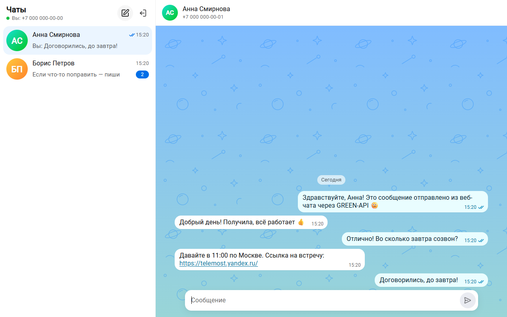
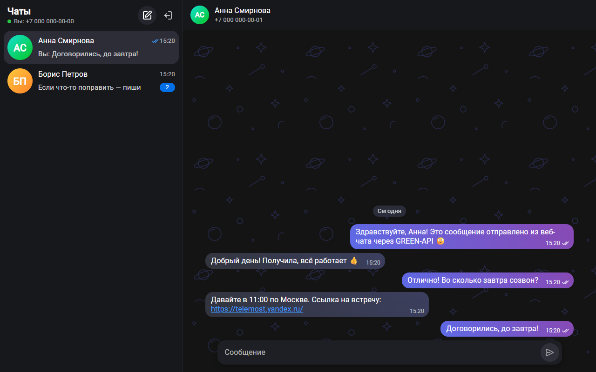
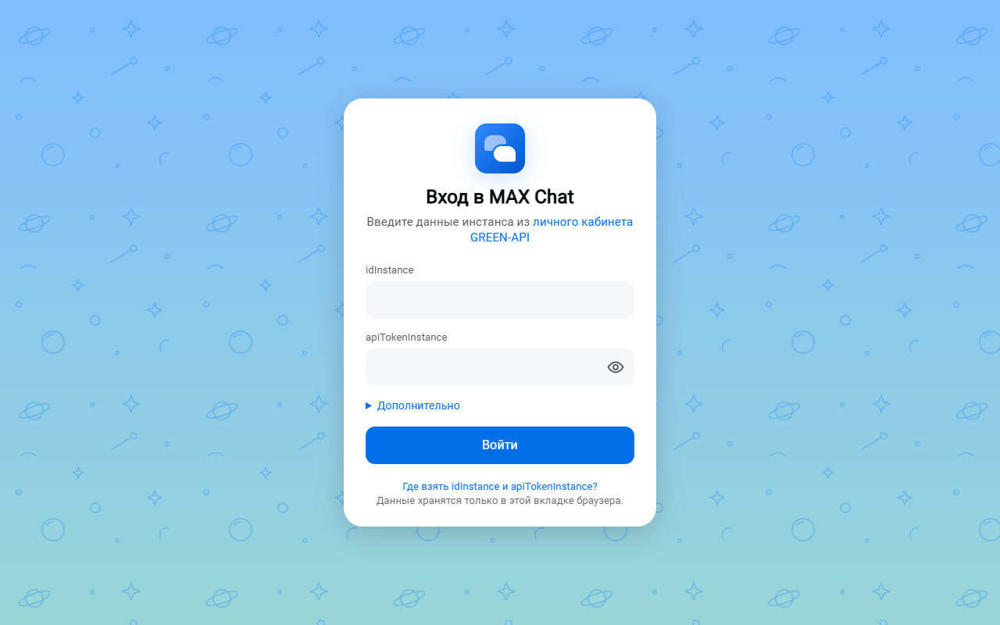
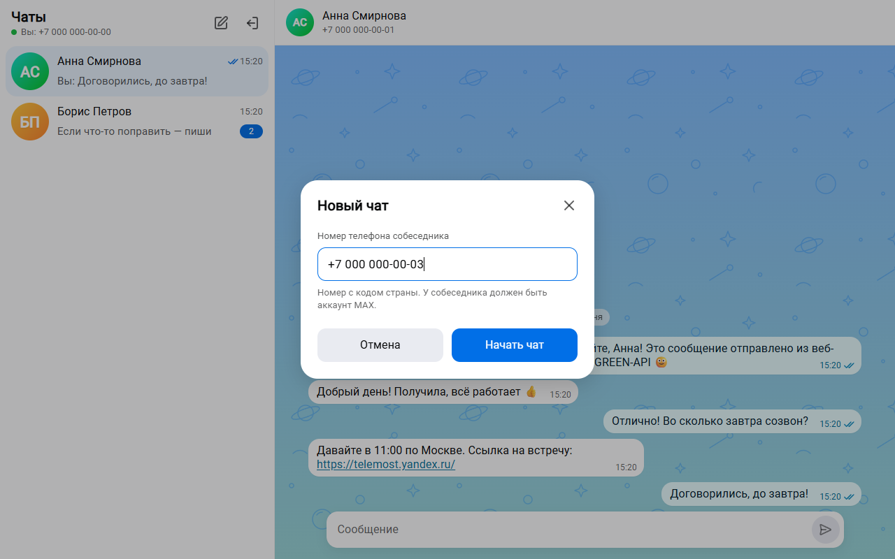
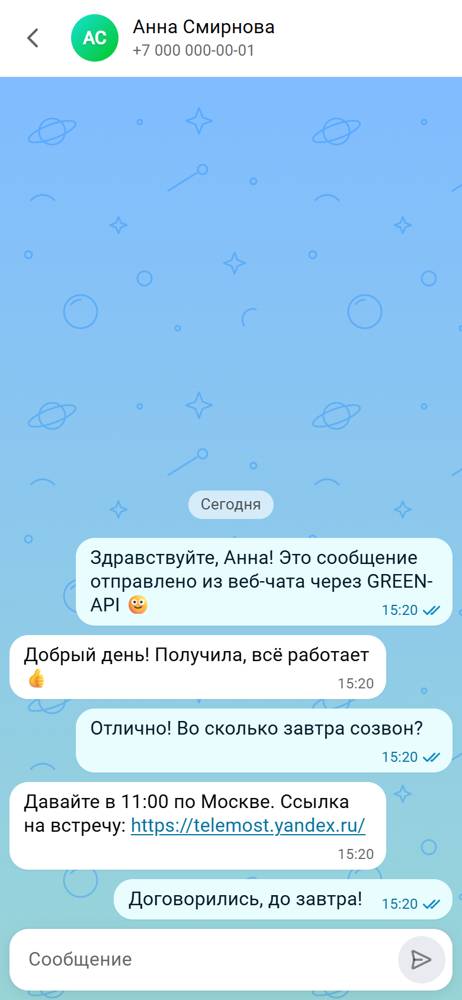

# MAX Chat — веб-чат для мессенджера MAX на GREEN-API

Тестовое задание на должность «Фронтенд-разработчик React» в [GREEN-API](https://green-api.com/max).

Интерфейс для отправки и получения **текстовых** сообщений в мессенджере MAX через сервис GREEN-API. Внешний вид — по мотивам [web.max.ru](https://web.max.ru/).

**Демо:** https://abdulazeez1718.github.io/green-api-max-chat/ · зеркало: https://green-api-max-chat-tan.vercel.app
**Быстрые ссылки:** [Локальный запуск](#локальный-запуск) · [Как пользоваться](#как-пользоваться) · [Скриншоты](#скриншоты) · [Архитектура](#как-это-устроено)



## Соответствие заданию

| Требование                                | Реализация                                                                                                                                                                                                                               |
| ----------------------------------------- | ---------------------------------------------------------------------------------------------------------------------------------------------------------------------------------------------------------------------------------------- |
| Вход по `idInstance` и `apiTokenInstance` | Форма входа. Данные проверяются запросом [GetStateInstance](https://green-api.com/v3/docs/api/account/GetStateInstance/) до входа в чат                                                                                                  |
| Новый чат по номеру телефона              | Диалог «Новый чат». Номер проверяется методом [CheckAccount](https://green-api.com/v3/docs/api/service/CheckAccount/), он же возвращает `chatId`                                                                                         |
| Отправка текста методом SendMessage       | [SendMessage](https://green-api.com/v3/docs/api/sending/SendMessage/), сообщение сразу видно в чате со статусом «отправляется»                                                                                                           |
| Получение методом HTTP API                | Цикл [ReceiveNotification](https://green-api.com/v3/docs/api/receiving/technology-http-api/ReceiveNotification/) → обработка → [DeleteNotification](https://green-api.com/v3/docs/api/receiving/technology-http-api/DeleteNotification/) |
| Ответ получателя виден в чате             | Входящее сообщение попадает в нужный чат, даже если чат создан по номеру, а MAX присылает ID пользователя                                                                                                                                |
| Только текстовые сообщения                | Текст, текст со ссылкой, ответ-цитата. Остальные типы показываются короткой заглушкой («Фото — просмотр не поддерживается»), чтобы ничего не терялось                                                                                    |
| Внешний вид web.max.ru                    | Цвета, шрифты, скругления и размеры взяты из CSS-переменных web.max.ru (тема «space»), светлая и тёмная тема по настройке системы                                                                                                        |
| Максимально просто                        | Два экрана: вход и чат (список чатов + переписка). Без лишних функций                                                                                                                                                                    |
| React                                     | React 19 + TypeScript                                                                                                                                                                                                                    |

## Как пользоваться

1. В [личном кабинете GREEN-API](https://console.green-api.com/) создайте инстанс MAX и авторизуйте его (QR-код или номер телефона).
2. Скопируйте `idInstance` и `apiTokenInstance`.
3. Откройте [демо](https://abdulazeez1718.github.io/green-api-max-chat/) и войдите. Поле «Дополнительно → apiUrl» менять не нужно: по умолчанию `https://api.green-api.com/v3`.
4. Нажмите «Новый чат», введите номер собеседника с кодом страны (подходят записи `+7 XXX XXX-XX-XX`, `8 XXX XXX-XX-XX` и `7XXXXXXXXXX`) и «Начать чат».
5. Напишите сообщение и нажмите Enter (Shift+Enter — новая строка). Когда собеседник ответит в MAX, ответ появится в чате.

Если у инстанса выключены уведомления о входящих сообщениях или задан `webhookUrl` (тогда очередь HTTP API недоступна), чат покажет предупреждение и кнопку «Исправить настройки» ([SetSettings](https://green-api.com/v3/docs/api/account/SetSettings/)).

> На бесплатном тарифе «Разработчик» число собеседников в месяц ограничено. Если лимит исчерпан, чат покажет сообщение об этом (ошибка 466 или уведомление `quotaExceeded`).

## Локальный запуск

Нужен **Node.js 24 LTS** (или 22.22+) и npm.

```bash
git clone https://github.com/abdulazeez1718/green-api-max-chat.git
cd green-api-max-chat
npm ci
npm run dev
```

Откройте http://localhost:5173 и войдите с данными своего инстанса. Сервер и переменные окружения не нужны: приложение обращается к GREEN-API напрямую из браузера.

Сборка для продакшена:

```bash
npm run build     # проверка типов + сборка в dist/
npm run preview   # локальный просмотр сборки
```

| Скрипт                  | Что делает                                     |
| ----------------------- | ---------------------------------------------- |
| `npm run dev`           | dev-сервер Vite                                |
| `npm test`              | все тесты (Vitest)                             |
| `npm run test:coverage` | тесты с отчётом о покрытии                     |
| `npm run lint`          | ESLint (typescript-eslint strict, react-hooks) |
| `npm run typecheck`     | проверка типов TypeScript                      |
| `npm run check`         | типы + линтер + форматирование + тесты         |

## Как это устроено

```
src/
├── api/              клиент GREEN-API: запросы, ошибки, типы
├── notifications/    разбор уведомлений, цикл получения, блокировка вкладки
├── store/            состояние (Zustand): сессия, чаты; чистая логика чатов
├── hooks/            отправка сообщений, проверка инстанса, заголовок вкладки
├── components/       экраны и компоненты интерфейса (CSS Modules)
├── lib/              телефоны, даты, ссылки, валидация
└── test/             MSW и имитация GREEN-API для интеграционных тестов
```

**Отправка.** Сообщение сразу появляется в чате со статусом «отправляется», затем вызывается `SendMessage`. Ответ с `idMessage` подтверждает отправку. Дальше статус обновляют уведомления `outgoingMessageStatus`: одна галочка — отправлено, две — доставлено, две синие — прочитано. При ошибке под сообщением появляются причина и кнопка «Повторить».

**Получение (HTTP API).** Один цикл на вкладку:

1. `ReceiveNotification?receiveTimeout=20` — long polling: сервер держит запрос, пока не появится уведомление.
2. Уведомление разбирается и применяется к состоянию.
3. `DeleteNotification/{receiptId}` — только после обработки.

Обработка идемпотентна: повторная доставка того же уведомления (например, если `DeleteNotification` не дошёл) не создаёт дублей. «Битое» уведомление не останавливает очередь. Временные ошибки — повтор с экспоненциальной задержкой (1 → 30 с, с разбросом), при появлении сети — сразу. Неверный токен останавливает цикл с понятным сообщением.

**Одна вкладка.** Каждое уведомление из очереди получает только один клиент. Поэтому, как в веб-версиях мессенджеров, очередь опрашивает одна вкладка ([Web Locks API](https://developer.mozilla.org/docs/Web/API/Web_Locks_API)). Во второй вкладке появится «Чат открыт в другой вкладке» с кнопкой «Использовать здесь».

**Чей это ответ.** Чат создаётся по номеру, а MAX в уведомлениях присылает числовой ID пользователя (`"chatId": "<ID пользователя MAX>"`). Поэтому номер сначала проверяется через `CheckAccount`, и чат сразу хранит его `chatId`. Если `CheckAccount` недоступен, чат открывается по номеру (`<номер>@c.us`), а ID пользователя привязывается к нему позже по `senderPhoneNumber` входящего сообщения или по эху своего же сообщения.

**Гонки.** Эхо `outgoingAPIMessageReceived` и статус доставки могут прийти раньше ответа `SendMessage`. Эхо сопоставляется с отправляемым сообщением, а статус ждёт, пока станет известен `idMessage`. Статусы только «продвигаются»: «прочитано» не откатится к «доставлено».

**Хранение.** Учётные данные — в `sessionStorage`: переживают перезагрузку, удаляются при закрытии вкладки. История — в `localStorage`, отдельно для каждого инстанса, не больше 500 сообщений на чат. «Выйти» удаляет и то, и другое.

**Безопасность.** Ответы GREEN-API об ошибках содержат токен в поле `path`. Поэтому интерфейс показывает только текст ошибки, а токен вычищается. В сборке есть Content-Security-Policy. Текст сообщений выводится только как текст: ссылки делаются кликабельными лишь для `http(s)` и с `rel="noopener noreferrer"`.

**Доступность.** Семантическая разметка и подписи у кнопок-иконок. Лента сообщений — `role="log"`, а модальное окно — нативный `<dialog>`. Контраст соответствует WCAG AA, поддерживается `prefers-reduced-motion`. Lighthouse: Accessibility 100, Best Practices 100.

## Тесты

73 теста (Vitest + Testing Library + MSW):

- **интеграционные** — весь путь из задания на имитации GREEN-API: вход → новый чат по номеру → отправка → статус «прочитано» → ответ собеседника виден в чате; ошибки входа, номер без MAX, ошибка отправки и повтор, исправление настроек инстанса;
- **клиент API** — адреса методов, тела запросов, разбор ошибок 400/401/466/5xx, отмена запроса, токен не попадает в текст ошибки;
- **разбор уведомлений** — на примерах из официальной Postman-коллекции GREEN-API для MAX;
- **логика чатов** — сопоставление по номеру и ID, дубли, порядок, гонки эха и статусов, правка и удаление;
- **цикл получения** — порядок, удаление из очереди, повторы, остановка при неверном токене.

CI (GitHub Actions) на каждый push проверяет типы, линтер, форматирование, тесты и сборку. Ветка `main` автоматически публикуется на GitHub Pages.

## Технологии

React 19 · TypeScript 6 · Vite 8 · Zustand 5 · CSS Modules · Vitest 5 · Testing Library · MSW 2 · ESLint 10 (typescript-eslint strict + react-hooks) · Prettier · GitHub Actions

## Ограничения

- По заданию поддерживается только текст: медиа и другие типы сообщений показываются заглушкой.
- История хранится локально в браузере. Загрузку истории с сервера (`GetChatHistory`) можно добавить отдельно — в задании её нет.
- Учётные данные вводятся в браузере и хранятся только в текущей вкладке. Для продакшена с несколькими пользователями токен лучше держать на сервере (BFF).

## Скриншоты

Скриншоты сделаны на тестовых данных: имена вымышленные, номера заведомо несуществующие (код `000`).

| Светлая тема                                     | Тёмная тема                                    |
| ------------------------------------------------ | ---------------------------------------------- |
|  |  |

| Вход                                | Новый чат                                   | Телефон                                 |
| ----------------------------------- | ------------------------------------------- | --------------------------------------- |
|  |  |  |

## Автор

Абдулазиз Кимсанбаев — Telegram [@akabdulazeez](https://t.me/akabdulazeez)
